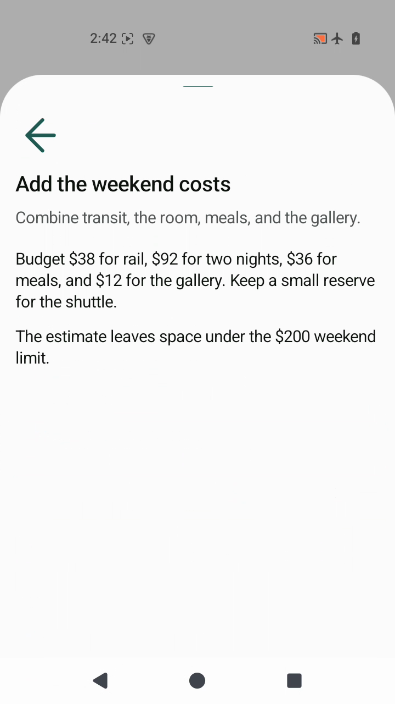
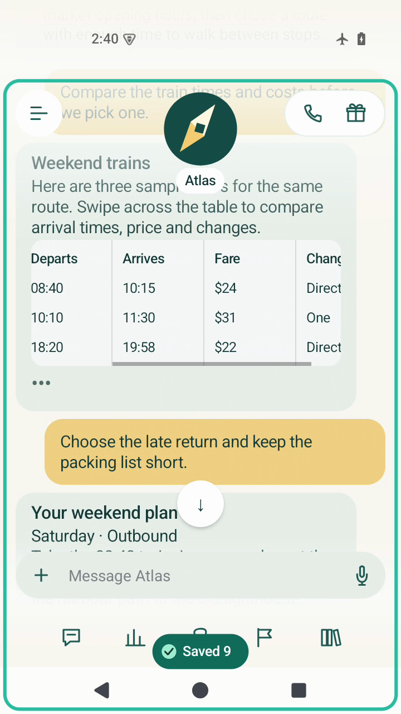

# Walkthrough Capture

Walkthrough Capture turns an on-screen conversation into a ZIP of overlapping screenshots and records selected activities as one continuous, silent video. It uses Android Accessibility to navigate exposed controls. Capture, previews and masking run on the device. The app requests neither internet nor microphone permission.

## Watch automatic capture

These silent Android recordings show the recorder operating an offline sample with fictional conversations and activities. Select a preview to play the demo in your browser.

| Trajectory capture · 1 min 31 s | Screenshot capture · 54 s |
| --- | --- |
| [](https://wryan2986.github.io/walkthrough-capture-android/) | [](https://wryan2986.github.io/walkthrough-capture-android/screenshots.html) |
| [Watch trajectory capture](https://wryan2986.github.io/walkthrough-capture-android/). Select two activities and watch the recorder open all four step details in sequence. | [Watch screenshot capture](https://wryan2986.github.io/walkthrough-capture-android/screenshots.html). Watch a collapsed section open, a table scroll sideways and the edge pulse as the recorder saves 15 screenshots to a ZIP. |

## Android

1. Install on Android 11 or later. In **Set up**, enable the Walkthrough Capture accessibility service.
2. Open the conversation in the target app, then return to Walkthrough Capture.
3. Choose a capture type.
   - **Conversation screenshots** rewinds the conversation, takes screen-sized PNGs with overlap and visits supported disclosures and horizontal panes. **Screenshot feedback** lets you choose Edge pulse, Save chip, Live counter or Off.
   - **Trajectory video** finds activities in an inclusive time range. Choose the individual activities to include, pick a tap highlight and approve Android screen recording. The recorder opens the selected activities and their steps in sequence.
4. When the capture finishes, review it in **Capture saved**. You can browse the screenshots, play the MP4, or use **Save to Files** to export a copy. **Library** keeps a local thumbnail for each capture.

Fixed privacy masks cover screen regions in either format. Screenshots can also mask accessible text matching email addresses, phone numbers or literal terms. Review exports before sharing. A partial result indicates that the recorder could not verify the entire walkthrough.

The built-in profile targets the Muse Android app. Use it with apps and accounts for which you have permission to automate and record. This is an independent project.

## iPhone

The native iPhone companion saves settings, previews screenshot ZIPs and silent MP4s, and exports through Files. Automatic cross-app capture runs from a Mac with Xcode. Both workflows have been exercised on an iPhone simulator with the included offline sample. A production Muse iOS profile still needs validation on a physical iPhone. [Build and run the iOS project](ios/README.md).

## Build and test

Use JDK 17, Android SDK Platform 35 and Build Tools 35.0.0. From the repository root, run:

```sh
./gradlew :app:assembleDebug
./qa/run.sh
```

The APK is generated under `app/build/outputs/apk/debug/`. The offline Java checks cover time ranges, navigation order, overlap and privacy matching. The optional ZIP verification tests use Python with Pillow.
